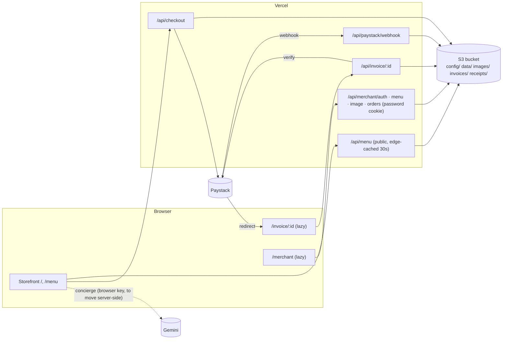

# Architecture (Sprint 2)

## Layers (dependencies point down)
| Layer | Path | Rule |
|---|---|---|
| Pages | `src/pages` | Compose; own screen state. `MerchantPage` and `InvoicePage` are lazy chunks |
| Components | `src/components/{storefront,cart,invoice,merchant,layout,ui,icons,chat}` | Presentational |
| Hooks | `src/hooks` | `useCart` (persisted), `useCheckout`, `useInvoice`, `useCarousel`, overlays |
| Services | `src/services` | `api.js` (our API), `concierge.js` (Gemini), `imageCompress.js` |
| Lib | `src/lib` | Pure, shared by browser **and** server (`pricing`, `menuDoc`, `search`, `settings`, `hours`…) |
| API | `api/*`, `api/_lib/*` | Vercel Functions; `_lib` = storage, auth, paystack, invoices, http |
| Dev | `dev/apiPlugin.js` | Serves `/api` from `npm run dev` with local-file storage |

## Key decisions
- **Shared pure logic.** `src/lib/pricing.js` and `menuDoc.js` run in the browser (instant feedback) and on the server (authority). One implementation, one set of tests.
- **Menu data flow.** First paint = last good menu on the device, else the bundled 64-item catalogue; then `/api/menu` (edge-cached 30 s). The storefront never shows an empty screen if storage is down.
- **Storage interface** (`getJSON/putJSON/remove/list/putBinary/publicUrl`) with S3, filesystem and memory drivers.
- **Cart** stores `{id, quantity}` only, persisted in `localStorage`, resolved against the live menu each render (sold-out/removed/repriced items are always current).
- **Security boundaries:** (1) the merchant cookie, checked by `requireMerchant` on every protected handler; (2) Paystack `verify` for payment truth; (3) server-side pricing; (4) private bucket except `images/*`.
- **Budgets:** storefront JS 112 KB gzip (limit 150). Merchant (12.7 KB) and invoice (5.6 KB) chunks load only on their routes.

## Function count
8 functions (Vercel Hobby allows 12): `menu`, `checkout`, `invoice/[id]`, `paystack/webhook`, `merchant/{auth,menu,image,orders}`.
