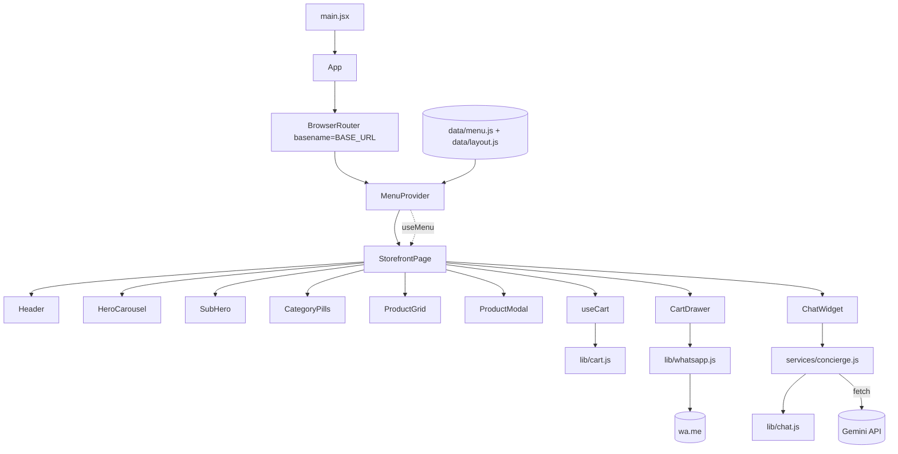
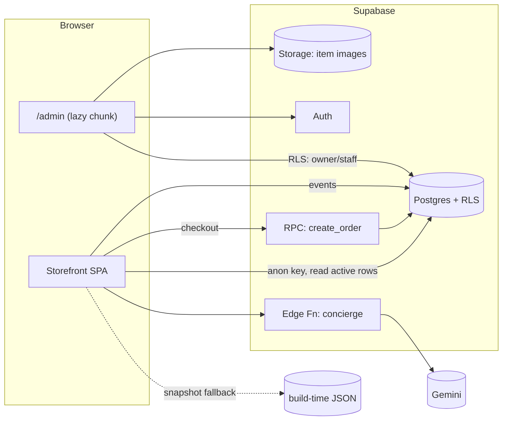

# Architecture

Status: **Sprint 1 (as built)** + **target for Phases 2–3**. Decisions live in [adr/](adr).

## 1. Sprint 1 — as built

### Layers (dependencies point downward only)
| Layer | Path | Rule |
|---|---|---|
| Pages | `src/pages` | Compose components + hooks; own screen-level state |
| Components | `src/components` | Presentational; props in, events out |
| Hooks | `src/hooks` | React state/effects; no JSX |
| Services | `src/services` | Network I/O only |
| Lib | `src/lib` | Pure functions; 100% unit-testable; no React, no I/O |
| Data / Config | `src/data`, `src/config` | Static values |

### Key design points
- **Menu seam:** UI reads menu via `useMenu()` → `{ activeItems, byId, categories, hero, subhero }`, produced by the pure `buildMenuModel`. Phase 2 changes only `MenuProvider`.
- **Cart:** `[{id, quantity}]` in a `useReducer`; lines resolved against `byId` each render. Prices cannot go stale; removed items vanish from the tray.
- **Hero/sub-hero:** id lists in `data/layout.js`; items missing or inactive are skipped (never a broken slide).
- **Routing:** `/` and `/menu` (same page, scrolls to menu, own SEO tags). Unknown paths redirect home. `vercel.json` rewrites everything to `index.html`.
- **Base path:** `base: "/"`; `build:ghpages` overrides to `/jays-bistro/`; `BrowserRouter` `basename` follows `BASE_URL`.
- **Concierge:** pure prompt/parse/sanitise in `lib/chat.js`; network in `services/concierge.js`; key via `VITE_GEMINI_API_KEY` (demo mode when empty).
- **Performance:** 103 KB gzip JS; images lazy (hero slide 1 eager); `svh` units prevent URL-bar layout shift.

## 2. Target — Phases 2–3

- **Read path:** SWR fetch → localStorage cache → static snapshot. The storefront never shows an empty menu because the backend is down.
- **Write path:** only the dashboard, only through RLS (`is_staff()` / `is_owner()` helper functions).
- **Orders:** `create_order(items jsonb)` is `SECURITY DEFINER`, recomputes prices from `menu_items`, returns an order code. Client prices are never trusted.
- **Admin bundle** is code-split so customers never download it.
- **Observability (S7):** error tracking, Vercel analytics for web vitals, Supabase logs.

## 3. Non-functional budgets
| Area | Budget |
|---|---|
| Home JS (gzip) | ≤ 150 KB |
| LCP (mid-range Android, 4G) | ≤ 2.5 s |
| CLS | ≤ 0.05 |
| Menu freshness after edit | ≤ 60 s |
| Chat reply p95 | ≤ 4 s |
